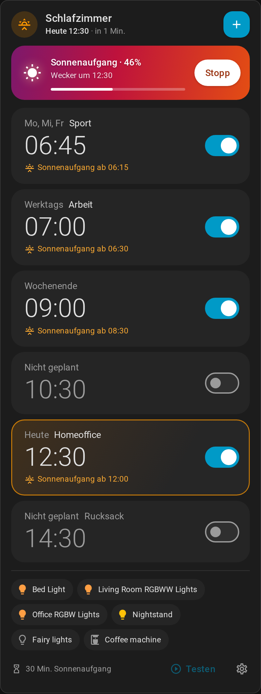
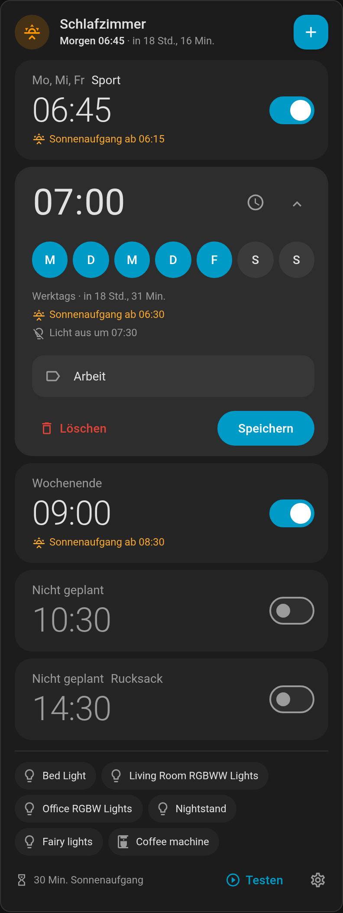
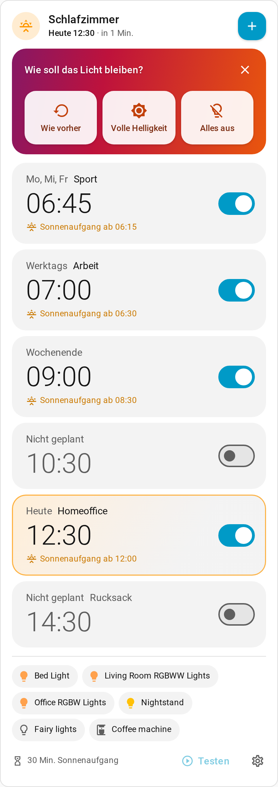

# Daytime Alarm

[](https://github.com/trittler/ha-daytime-alarm/releases)
[](https://github.com/trittler/ha-daytime-alarm/actions/workflows/validate.yml)
[](https://hacs.xyz/docs/faq/custom_repositories/)

[](https://my.home-assistant.io/redirect/hacs_repository/?owner=trittler&repository=ha-daytime-alarm&category=integration)
[](https://my.home-assistant.io/redirect/config_flow_start/?domain=daytime_alarm)

Sunrise wake-up alarms for Home Assistant. Before each alarm your lights brighten
slowly from 0 to 100 %, like a sunrise; switches (coffee machine, radio, …) turn on at
the alarm time, and the lights go off again 30 minutes later unless you stop the alarm.
Manage your alarms from a dashboard card that works like the alarm list on your phone.

Requires Home Assistant **2026.11** or newer.

<p>
  
  
  
</p>

## What you get

- **Dashboard card**: all alarms with big times and on/off switches. Tap an alarm to
  change its time, days and label; **+** adds one. Shows the next alarm ("Tomorrow 07:00 ·
  in 8h 12m"), a live sunrise banner whose **Stop** asks what to do with the lights,
  your devices, and a one-minute test. Follows your HA theme, language (English/German), 12/24 h setting and first day of the week.
- **Settings in HA**: *Settings → Devices & services → Daytime Alarm → Configure*:
  lights, switches, sunrise duration, sunrise colors, and when the lights turn off after the alarm.
- **Entities** you can use anywhere (automations, voice, other cards):

  | Entity | What it is |
  | --- | --- |
  | `switch.<name>_alarm_<n>` | One per alarm; on = armed. Attributes: `time`, `days`, `label`, `next_alarm`, `sunrise_start` |
  | `sensor.<name>_next_alarm` | Timestamp of the next alarm |
  | `sensor.<name>_status` | `idle`, `sunrise` (lights ramping up) or `awake` (alarm rang, lights on); attributes `progress`, `alarm_at`, `lights_off_at` |
  | `button.<name>_stop_lights_as_before` | Stop the alarm; lights go back to how they were before the sunrise |
  | `button.<name>_stop_full_brightness` | Stop the alarm; lights to full brightness |
  | `button.<name>_stop_all_lights_off` | Stop the alarm; all lights off |
  | `button.<name>_test_sunrise` | One-minute sunrise with your lights, then back to how they were (switches are left alone) |

  (Entity IDs follow your Home Assistant language, e.g. `sensor.schlafzimmer_status`.)

You can set up several wake-up lights (e.g. one per bedroom); each has its own devices
and alarms, and each card picks one.

## How the sunrise works

The sunrise starts *duration* minutes before the alarm and reaches 100 % at the alarm time.

| Device | During the sunrise | At the alarm time |
| --- | --- | --- |
| RGB / RGBW / RGBWW lights | Deep red → orange → neutral white, 0 → 100 % | 100 % |
| Color temperature lights | Warm → neutral white (within the light's range), 0 → 100 % | 100 % |
| White (dimmable only) lights | 0 → 100 % | 100 % |
| On/off-only lights | – | On |
| Switches / input booleans | – | On |

After the alarm the lights stay on and turn **off 30 minutes after the alarm time**
(setting *Lights off after the alarm*; 0 keeps them on). Lights you changed in the
meantime, and lights that were already fully on before the sunrise, are left alone.
Switches stay on.

### Stopping

**Stop** (during the sunrise or while the lights are on after the alarm) asks what to do:

| Choice | Lights |
| --- | --- |
| **As before** | Back to exactly how they were before the sunrise (on/off, brightness, color) |
| **Full brightness** | 100 % |
| **All off** | All the wake-up light's lamps off |

After a stop nothing else happens for that alarm: no automatic lights-off, and switches
that were not on yet stay off. One-time alarms switch themselves off.

Turn off *Sunrise colors* to change brightness only.

Details that make it pleasant to live with:

- **Never dims a light down.** A light that is already brighter is left alone until the
  sunrise catches up.
- **Respects you.** Turn a light off (or dim it) during the sunrise and it is left alone.
- **Late alarms ramp from dark.** Set an alarm for 10 minutes from now and the lights
  start at 1 % instead of jumping to 66 %.
- **Survives restarts.** If Home Assistant restarts mid-sunrise it continues where it
  was; the lights still turn off on time, and "As before" still knows the earlier state.
- **One-time alarms** (no days selected) switch themselves off after ringing, like on your phone.
- Uses light transitions where the light supports them, for a smooth ramp.

### Zigbee bulbs (ZHA, Zigbee2MQTT, Hue bridge, deCONZ)

Daytime Alarm controls lights through Home Assistant's normal light actions, so any Zigbee
setup works. The sunrise is built for how Zigbee bulbs behave:

- **No flash at the start.** A light that is off switches on at 1 % in the start color
  without a fade; fading up from off makes many bulbs show yesterday's color and
  brightness for a moment.
- **Brightness and color take turns.** Many bulbs (IKEA's, for example) can fade only one
  thing at a time and drop the other, so each step changes either the brightness (with a
  fade) or the color (too small a change to see), never both at once.
- **Starts at 1 %, not at the lowest level**: some bulbs switch off when sent brightness 1.
- **Calm on the network**: at most one update per light every 5 seconds (about every 9 seconds
  for a 30-minute sunrise).
- **Bulbs without power** (wall switch off) are skipped and join in once they're back.

Several bulbs in one room? Pick their **Zigbee group** (a ZHA group or a Zigbee2MQTT
group) instead of the single bulbs: one command per step reaches all of them at once, so
they stay in sync with less radio traffic. (A Home Assistant *light group* helper still
sends to every bulb separately.)

## Installation

### HACS (recommended)

1. [](https://my.home-assistant.io/redirect/hacs_repository/?owner=trittler&repository=ha-daytime-alarm&category=integration)

   This opens HACS in your Home Assistant with this repository filled in (the first time,
   my.home-assistant.io asks for your Home Assistant's address). Click **Download**.
2. Restart Home Assistant.
3. [](https://my.home-assistant.io/redirect/config_flow_start/?domain=daytime_alarm)

Without the buttons: HACS → ⋮ → *Custom repositories* → `https://github.com/trittler/ha-daytime-alarm`,
type *Integration* → download **Daytime Alarm** → restart. Updates then show up under
*Settings → Updates* like any other.

### Manual

Copy `custom_components/daytime_alarm` into your Home Assistant `config/custom_components/`
folder and restart Home Assistant.

The card ships with the integration and registers itself; you don't add a dashboard resource.

## Setup

1. *Settings → Devices & services → Add integration → Daytime Alarm* (or the button above).
2. Give it a name (e.g. "Bedroom"), pick lights and switches, and choose how long the sunrise lasts.
3. Edit a dashboard → *Add card* → **Daytime Alarm** (search for "Daytime" or "Wecker").

Card not in the list? It comes with the integration, so add the integration first, then
reload the page once (in the app: pull down). Home Assistant's *Suggested cards* only ever
lists its built-in cards; tap the ☆ on the Daytime Alarm card in the picker to keep it at
the top instead.

Card options (all optional; the visual editor covers them):

```yaml
type: custom:daytime-alarm-card
entry_id: 01J...          # which wake-up light; defaults to the first one
title: Wecker             # defaults to the wake-up light's name
show_devices: true        # device chips in the footer
```

## Services

```yaml
# Create (returns alarm_id and entity_id). config_entry_id is only needed with several wake-up lights.
action: daytime_alarm.create_alarm
data:
  time: "06:30"
  days: [mon, tue, wed, thu, fri]   # leave out to ring once
  label: Work

# Change (fields you leave out stay as they are)
action: daytime_alarm.update_alarm
target:
  entity_id: switch.bedroom_alarm_1
data:
  time: "07:15"

# Delete
action: daytime_alarm.delete_alarm
target:
  entity_id: switch.bedroom_alarm_1
```

```yaml
# Stop the alarm (e.g. from a bedside button): restore | full | off
action: daytime_alarm.stop
data:
  action: restore
```

Arm/disarm with the normal `switch.turn_on` / `switch.turn_off`.

## Events and automation ideas

- `daytime_alarm_sunrise_started` when a sunrise begins
- `daytime_alarm_alarm` at the alarm time
- `daytime_alarm_stopped` when someone stops it (`config_entry_id`, `action`)

The first two carry `config_entry_id`, `alarm_id`, `entity_id`, `label`, `time` and `alarm_at`.

```yaml
# Play music when the alarm rings
triggers:
  - trigger: event
    event_type: daytime_alarm_alarm
actions:
  - action: media_player.play_media
    target:
      entity_id: media_player.bedroom
    data:
      media_content_id: "spotify:playlist:..."
      media_content_type: playlist
```

```yaml
# No alarms while on vacation
triggers:
  - trigger: state
    entity_id: input_boolean.vacation
    to: "on"
actions:
  - action: switch.turn_off
    target:
      entity_id: [switch.bedroom_alarm_1, switch.bedroom_alarm_2]
```

## Development

```
card/                    Lovelace card (TypeScript + Lit), built into the integration
custom_components/…      The integration
dev/                     Local Home Assistant (Docker) and helper scripts
tests/                   pytest tests (pytest-homeassistant-custom-component)
```

- Card: `cd card && npm install && npm run build` (writes
  `custom_components/daytime_alarm/frontend/daytime-alarm-card.js`; commit the built file).
- Tests and lint: `dev/test.sh`
- Local Home Assistant: see [INFRA.md](INFRA.md).
